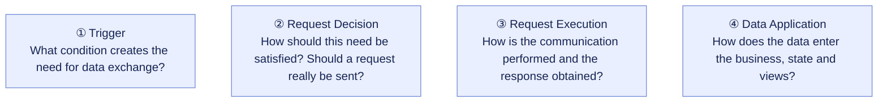
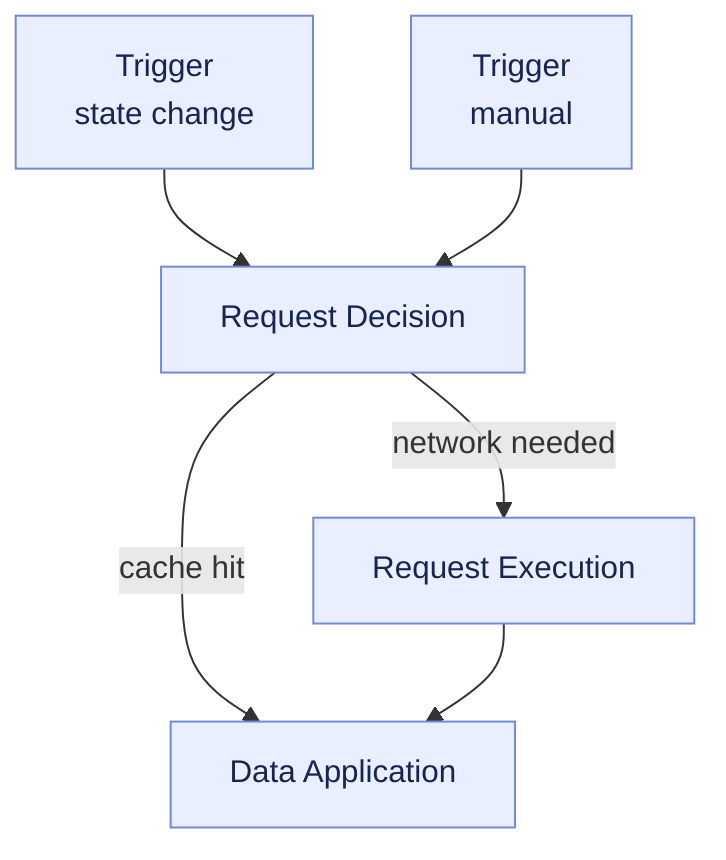
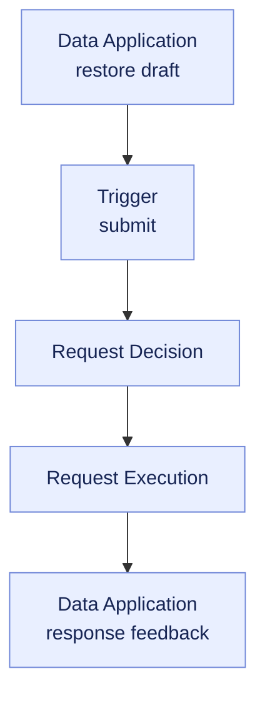
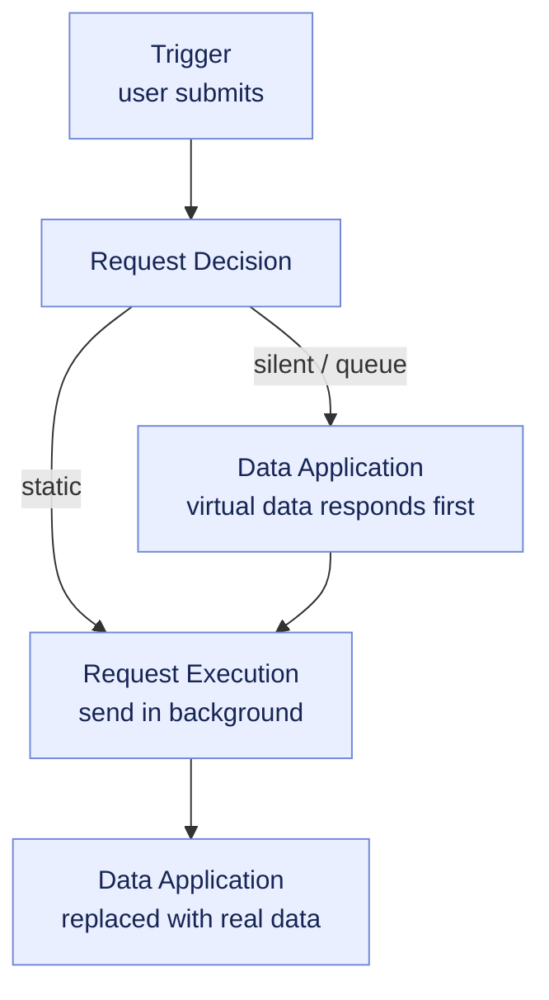

The Request Scene Model (RSM) is the request scenario concept model proposed by alova. It describes the core stages involved in data exchange, and how different request strategies organize these stages and the data flow between them.

In modern applications, a request is not just sending data to the server and waiting for a response. Developers also need to deal with when a request is triggered, how the way to obtain data is decided, how network communication is performed, and how data is transformed and applied to business logic, application state and views.

Through different request strategies, alova combines these capabilities into solutions suitable for different scenarios. RSM provides a unified conceptual foundation for these strategies, helping developers understand the responsibilities of each strategy, as well as the differences and connections between them.

## Core model

RSM abstracts a request scenario into four stages:

- **Trigger**: what condition creates the need for data exchange?
- **Request Decision**: how should this need be satisfied? Does it need to actually send a request?
- **Request Execution**: how is the data communication performed and the response obtained?
- **Data Application**: how is the data used for business logic, application state and view rendering?

These four stages describe different responsibilities in data exchange, instead of prescribing a fixed flow that every request must go through in order.

### RSM concept figure

The figure presents the responsibilities of the four stages, not a request flow. There is no fixed order between the stages: which stages participate and in what order is decided by the request strategy in use. A strategy may skip some stages, go through some stages repeatedly, or handle several data streams at the same time.

## 1. Trigger

**Trigger answers: what condition creates the need for data exchange?**

The trigger mechanism decides when data exchange happens, and what condition starts a new request. It does not mean that a network request will definitely be sent.

Common triggers include:

- **Manual trigger**: a user clicks a button, submits a form, or explicitly calls a request method.
- **Initialization trigger**: data is fetched when a page or component initializes.
- **State trigger**: search conditions, filter parameters and other states change.
- **Time trigger**: scheduled refresh, delayed execution.
- **Event trigger**: the page regains focus, the network reconnects, and other events.
- **Failure retry**: after a request fails, a new request is sent according to the retry condition, count and interval.

For example, `useWatcher` can trigger a request when a state changes, `useAutoRequest` can send a request again according to the specified auto-refresh conditions, and `useRetriableRequest` can schedule new attempts after a request fails.

These strategies all deal with when a request happens, but whether real communication is needed after the trigger is still decided by the request decision stage.

## 2. Request Decision

**Request decision answers: how should this data need be satisfied?**

After a request is triggered, a new network request is not necessarily needed. alova can choose a suitable way to obtain data based on existing data, requests that are in flight, and the current conditions.

Common decisions include:

- **Cache hit**: use existing data directly to avoid repeated communication.
- **Request sharing**: reuse an identical request that is already in flight and its result.
- **Request interception**: prevent the original request from continuing.
- **Request redirection**: change the execution path of the original request.
- **Request pending**: wait until the condition is satisfied, then continue.
- **Execute a network request**: enter the request execution stage when data needs to be obtained over the network.

For example:

- On a cache hit, the cached data can be handed directly to the data application stage.
- When requests are shared, the existing communication can be reused instead of sending again.
- When offline, the request can be deferred until the network recovers.
- Only when the cache is unavailable and server data is needed does the request enter the request execution stage.

The point of the request decision is: developers express the data need, while the strategy decides how to satisfy it.

## 3. Request Execution

**Request execution answers: how is the actual data communication performed and the response obtained?**

When the request decision determines that network communication is needed, the request enters this stage. It focuses on sending the request, receiving the response, and the execution result of success or failure.

Typical scenarios include:

- Send an HTTP request and receive the server response.
- Handle communication success and failure.
- Receive continuously transmitted data such as SSE.
- Perform special transmission tasks such as file uploads.

Request execution does not decide when a request is triggered, nor whether the cache is used.

Therefore, one data need may produce no new network communication at all, or may require several executions to obtain the needed data.

## 4. Data Application

**Data application answers: how is the data used in real scenarios?**

The purpose of data communication is not only to obtain a response, but to let the data serve business logic and application features.

Data application includes:

- **Data transformation**: extract, format or transform data so that it fits business needs.
- **Cache deposit**: save data for reuse by later requests or other places.
- **State update**: write data into application state for later logic.
- **Data passing**: hand data to the server or to subsequent steps in the business flow.
- **Data synchronization**: apply data updates to other components, pages or related places where the data is used.

Data application is not limited to the front-end UI, and it does not require all data to go through a state update. It describes how data is actually used.

For example, on the client, response data can be transformed, written into state and used to update the view; on the server, data can be transformed and then passed directly to the next business step.

## 5. RSM in request strategies

The various client hooks and server hooks provided by alova can be understood as declarations of request strategies.

Using a hook means declaring that a certain request strategy is adopted. That strategy determines which RSM stages it involves, and how data flows between these stages.

Different strategies solve different problems, so the stages and flow paths they involve are also different. Some strategies cover a complete request scenario, some only involve a few of the stages, and some change the usual flow path.

For example:

- An ordinary request usually involves trigger, request decision, request execution and data application.
- On a cache hit, it can go straight from request decision to data application.
- Form draft recovery reads persisted form data and can restore state directly, without a network request.
- Silent submission reverses the order of stages: after request decision it enters data application first (receiving virtual data), request execution happens in the background, and once the real response returns it enters data application again to replace the virtual data.

### Stages are not a fixed execution order

**RSM describes stage responsibilities, not a fixed execution order.**

The four stages are not a linear flow that must be gone through in sequence. A specific strategy decides which stages participate, which are skipped, and how data flows between the stages.

Note that the flow of the request need and the flow of data are not exactly the same:

- The request need decides which way of obtaining data is used next.
- Data may come from the cache, from a request in flight, or from a new network response.
- Existing data can go directly into the data application stage without executing a new network request.
- After an execution fails, a request can be triggered again, forming a new attempt.

This design allows RSM to describe different request scenarios without building a separate conceptual model for every strategy.

## 6. RSM strategy examples

The following three scenarios show which stages different strategies involve, in what order they participate, and where the data comes from and where it ends up.

### Example 1: useWatcher — state change and manual trigger

When search conditions or filter parameters change, the application needs to fetch data matching the current conditions again. `useWatcher` watches the specified states and sends a request automatically when they change; it can also be triggered manually by explicitly calling `send`. It supports all the features of `useRequest`, but `immediate` defaults to `false`, so nothing is requested on initialization.

What happens in each stage:

1. **Trigger**: there are two paths. ① State change: a watched state (such as the search keyword) changes, creating a new data need; request debouncing belongs to the trigger mechanism — once `debounce` is configured, a further change within the debounce time restarts the timer, and this need is only really created when the time is up, so you no longer need to write debouncing code on the input yourself. ② Manual trigger: explicitly call `send` to send a request; `immediate` defaults to `false`, so the first request can be sent this way.
2. **Request decision**: `abortLast` defaults to `true`, so when a new request is sent, the previous request that has not responded yet is aborted, preventing an older response from overwriting a newer result when it returns late; if this request hits the cache, there is no need for repeated communication and it goes straight to data application.
3. **Request execution**: when network communication is needed, send the request and take the response back.
4. **Data application**: the response data is written into reactive states such as `data`, and the view updates accordingly.

This example shows that "when data is needed" and "whether this need should really be sent out" are two different things: both trigger paths only create a data need, debouncing belongs to the trigger mechanism, race handling and cache decisions belong to the request decision stage, and the execution stage only sends the request out and takes the response back.

### Example 2: useForm form draft — from draft recovery to submit feedback

`useForm` provides a form draft feature: when `store` is set to `true`, unsubmitted form data is persisted in real time (through the storage adapter on the alova instance), so even after refreshing the page, previously filled-in content can be restored the next time the form is opened.

What happens in each stage:

1. **Data application (restore draft)**: when the form re-initializes after a page refresh, the draft in storage is restored to form data, the `onRestore` event is triggered, and the view shows the previously filled-in content. This step only uses locally deposited data and involves no network communication.
2. **Trigger**: the user submits the form by calling `send`, creating a submit need.
3. **Request decision**: this submit needs to be really sent, so it goes straight into request execution; the draft is only local data and does not affect this submit.
4. **Request execution**: send the form data and get the response.
5. **Data application (submit feedback)**: the response result is fed back to the page — loading is shown while submitting, and success, failure and completion trigger `onSuccess`, `onError` and `onComplete` respectively; after a successful submit (with `resetAfterSubmitting` configured, or by calling `reset` manually) the form returns to its initial state, and the deposited draft is cleared as well.

This example shows that one strategy can cover several stages: draft recovery is the starting point in data application, the submit is a new trigger, and the response goes back to data application again for page feedback.

### Example 3: Silent submission — respond first, submit later

In a submit-and-respond scenario, the user should not wait for a network round trip. With `useSQRequest` and `behavior: 'silent'`, the request is handed to the silent queue: the call result returns immediately, while the request is really sent in the background in queue order.

What happens in each stage:

1. **Trigger**: the user's submit action (create, edit, delete) creates a data need.
2. **Request decision**: `behavior` decides the path of this request — `silent` enters the silent queue and is persisted, `queue` enters the queue without being persisted, and `static` does not enter the queue and is sent immediately (equivalent to turning silent submission off).
3. **Data application (immediate)**: in `silent` mode the response callback is triggered immediately, and `onSuccess` receives virtual data, that is, a placeholder for the server response data (for example the id generated by `silentDefaultResponse` when creating data). The application first uses it to update state and views, so the operation result is visible immediately.
4. **Request execution (background)**: the silent queue sends the requests for real in order, and the next request is only sent after the previous one has responded, which guarantees the timing; on failure it retries according to parameters such as `maxRetryTimes` and `backoff`; `silent` requests are persisted and continue to be sent by `bootSilentFactory` after a page refresh.
5. **Data application (after the response)**: once the real response returns, the tracing mechanism of virtual data automatically replaces the virtual data scattered across state, cache and views with the real data (such as the real id returned by the server); the saved operation records can also be used for data compensation when necessary.

The order of stages in this example differs from an ordinary request: data application happens before request execution. At the same time, note that "the response callback has run" does not mean "the request has succeeded" — in `silent` mode `onError` is never triggered, and failures are taken over by the retry strategy of the silent queue and events such as `onSilentSubmitFail` and `onFallback`.

It shows that request execution and data application are two independent stages: which comes first, and in what form the data is applied, depends on the specific request strategy.
