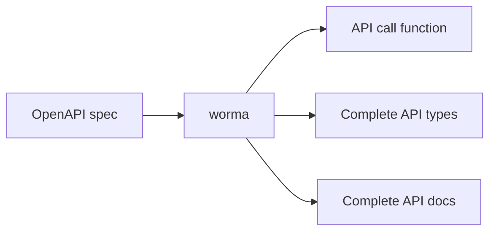
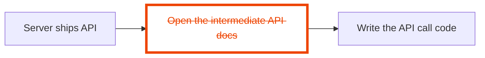

import Link from '@docusaurus/Link';
import NavCard from '@site/src/components/NavCard';
import Examples from '@site/src/components/Examples';
import SupportList from '@site/src/components/SupportList';
import tts from '@site/static/audio/tts.mp3';
import AudioPlayer from '@site/src/components/AudioPlayer';
import IconFont from '@site/src/components/IconFont';
import Tabs from '@theme/Tabs';
import TabItem from '@theme/TabItem';
import SponsorStrip from '@site/src/components/SponsorStrip';

## What is alova?

alova (pronounced /əˈləʊva/<AudioPlayer src={tts} />) is a **request strategy library**: it treats the scenario as the basic unit of a request, packaging the request logic you've hand-written countless times — pagination, forms, uploads, retries — into 20+ ready-to-use request strategies.

A request is not an instantaneous call — it is a scenario with a lifecycle. You don't have to throw away the axios or fetch you already know: alova builds right on top of your existing request library and takes over the request logic you keep rewriting. The same API set runs across React, Vue, Svelte, Solid, mini-programs and the server, so you learn it once and use it everywhere.

Learn about our story in [why built alova](/about/faqs), explore how we differ in our detailed [comparison with other request libraries](/about/comparison), or check out the [Request Scenario Model (RSM)](/about/RSM) — the conceptual foundation of alova.

### Introduction to the Request Scenario Model (RSM)

RSM (Request Scenario Model) expands a request scenario into four stages, each answering one question:

| Stage | What it answers | Details |
| --- | --- | --- |
| **Request Trigger** | What condition creates the need for data exchange? | Initialization, state changes, auto-refresh, retry on failure, debounce, polling — triggering doesn't mean sending: the need arises, but the network doesn't necessarily move |
| **Request Decision** | How should this need be met? Does a request actually need to be sent? | Cache hits, reusing in-flight requests, suspending until conditions are met, discarding stale responses — all of this happens here |
| **Request Execution** | How is the communication carried out and the response obtained? | Handed to axios / fetch / XHR — **usually just one line of code** |
| **Data Application** | How does data enter the business, state and view? | Data transformation, state updates, cross-component/cross-page sync, cache persistence |

Worth noticing: across the four stages, "execution" is usually just one line, while "trigger" is scattered in your components' data listeners and "application" is scattered in state assignments and view updates — and "decision" tends to be overlooked. See the full [Request Scenario Model (RSM)](/about/RSM).

### What you get with alova

#### 1. A complete scenario, not just a working request

Let AI write it from scratch, and these words will most likely never show up in your prompt — not because AI isn't capable enough, but because you didn't mention them. And as for "which words should be mentioned", nobody has ever handed you a checklist. RSM is that checklist, and alova maps it onto the configuration options of scenario hooks: one declaration, and the whole scenario is in place.

- **Input debounce**: without it, fast typing fires requests back to back
- **Cache hits for identical conditions**: without it, the same endpoint is called over and over
- **Discarding stale responses**: without it, an older response may overwrite a newer one
- **Automatic retry on failure**: without it, a single failed request leaves the page blank
- **Next-page preloading**: without it, users stare at the loading state on every page turn

#### 2. No need to review AI-written code

Request-layer code takes up a large share of your pages, and AI-written code always needs another round of review. With alova, the request layer is reduced to configuration you only need to verify — saving you time while improving stability.

### When should you use alova?

alova runs in virtually any JavaScript runtime. If your frontend app includes authentication, pagination, forms, uploads or captcha sending, or you need to reuse one API set across Web, React Native and mini-programs, or you need request governance such as rate limiting and BFF on Node.js or Bun servers, alova handles it all perfectly.

## Features

- Easy to use — [watch the video](/video-tutorial) and get started in 5 minutes.
- Perfect compatibility with your favorite tech stack.
- 20+ high-performance business modules to help you build better-performing apps faster.
- A more advanced OpenAPI solution for efficient interaction with API information right in your code.
- Request sharing and response caching to boost performance.
- Type safety.

alova is compatible with the following tech stacks; the grayed-out parts will be supported gradually in the future.

<SupportList showStatus></SupportList>

## Request Strategies in Action

Here are a few of the most common request strategies so you can get a feel for the actual code — just expand any item you like.

### Client request strategy

Below are introductions and examples of some client-side request strategies. Feel free to explore the ones that catch your interest.

<details>
<summary>Watching request strategy</summary>

Re-request as your data changes — e.g. fuzzy search or tab switching.

```javascript
const {
  // Responsive states
  loading,
  error,
  data,

  // Events
  onSuccess,
  onError,
  onComplete,

  // actions
  send,
  update

  // ...
} = useWatcher(
  () =>
    alova.Get('/api/user', {
      params: {
        type: activeTab
      }
    }),
  [activeTab]
);
```

See [Watcher Request Strategy](/tutorial/client/strategy/use-watcher) for details.

</details>

<details>
<summary>Pagination request strategy</summary>

Full pagination coverage: page turning, conditional query, next-page pre-fetch, insert/replace/remove, refresh and reset.

```javascript
const {
  // Responsive states
  loading,
  error,
  data,
  page,
  pageSize,
  total,

  // Events
  onSuccess,
  onFetchSuccess,
  onError,
  onFetchError,

  // Actions
  refresh,
  insert,
  replace,
  remove,
  reload,
  send,
  abort,
  update

  // ...
} = usePagination(
  (page, size) =>
    alova.Get('/api/user/list', {
      params: { page, size }
    }),
  {
    preloadNextPage: true,
    watchingStates: [username, sex],
    debounce: 500
  }
);
```

See [Pagination Request Strategy](/tutorial/client/strategy/use-pagination) for details.

</details>

<details>
<summary>Token authentication strategy</summary>

Global interceptors that centralize login, logout, token attachment and seamless token refresh.

```javascript
const { onAuthRequired, onResponseRefreshToken } = createServerTokenAuthentication({
  refreshTokenOnError: {
    isExpired: res => res.status === 401,
    handler: async () => {
      const { token, refresh_token } = await refreshToken();
      localStorage.setItem('token', token);
      localStorage.setItem('refresh_token', refresh_token);
    }
  }
});
const alovaInstance = createAlova({
  beforeRequest: onAuthRequired(),
  responded: onResponseRefreshToken()
});
```

See [Token Authentication Interceptor](/tutorial/client/strategy/token-authentication) for details.

</details>

<details>
<summary>Form submission strategy</summary>

Quickly build form drafts and multi-step forms, with built-in reset and other common helpers.

```javascript
const {
  // Responsive states
  loading: submiting,
  error,
  form,

  // Events
  onSuccess,
  onError,
  onComplete,

  // Actions
  send: submit,
  updateForm,
  abort

  // ...
} = useForm(formData => alova.Post('/user/profile', formData), {
  initialForm: {
    name: '',
    age: '',
    avatar: null
  },
  resetAfterSubmiting: true,
  store: true
});
```

See [Form Submission Strategy](/tutorial/client/strategy/use-form) for details.

</details>

<details>
<summary>Data Fetching Strategy</summary>

Fetch data ahead of time so users never wait for loading — a smoother experience.

```javascript
const {
  // Response states
  loading,
  error,

  // Events
  onSuccess,
  onError,
  onComplete,

  // actions
  fetch,
  update,
  abort

  // ...
} = useFetcher();

const handleItemClick = itemId => {
  fetch(
    alova.Get('/api/user/detail', {
      params: {
        id: itemId
      }
    })
  );
};
```

See [Data Fetching Strategy](/tutorial/client/strategy/use-fetcher) for details.

</details>

<details>
<summary>Seamless Data interaction Strategy</summary>

Respond as instantly as local data — both content display and submission happen without waiting, eliminating perceived lag.

```javascript
const {
  // Responsive states
  data,
  loading,
  error,

  // Events
  onSuccess,
  onError,
  onComplete,
  onBeforePushQueue,
  onPushedQueue,
  onFallback,

  // Actions
  send: submit,
  abort,
  update

  // ...
} = useSQRequest(() => alova.Get('/api/todo/add'), {
  behavior: 'silent',
  queue: 'queue-demo',
  silentDefaultResponse: () => {
    return {
      id: '--'
    };
  }
});
```

See [Seamless Data Interaction](/tutorial/client/strategy/seamless-data-interaction) for details.

</details>

<details>
<summary>Cross-component request triggering middleware</summary>

Break free from component hierarchy — trigger any request action from any component.

<Tabs className="file-tabs">
<TabItem value="1" label="ComponentA">

```javascript
useRequest(alova.Get('/api/todo/list'), {
  // ...
  middleware: actionDelegationMiddleware('action:todoList')
});
```

</TabItem>
<TabItem value="2" label="ComponentB">

```javascript
accessAction('action:todoList', delegatedActions => {
  delegatedActions.send();
  delegatedActions.abort();
});
```

</TabItem>
</Tabs>

See [Cross-component request trigger](/tutorial/client/strategy/action-delegation-middleware) for details.

</details>

<details>
<summary>Captcha strategy</summary>

Quickly implement captcha sending.

```javascript
const mobile = ref('');
const {
  // Responsive states
  loading: sending,
  countdown,
  error,

  // Events
  onSuccess,
  onError,
  onComplete,

  // Actions
  send,
  abort,
  update

  // ...
} = useCaptcha(
  () =>
    alova.Post('/api/captcha', {
      mobile: mobile
    }),
  {
    initialCountdown: 60
  }
);
```

See [Verification code strategy](/tutorial/client/strategy/use-captcha) for details.

</details>

See the [Request Strategy List](/tutorial/client/strategy) for all client request strategies.

### Server Request Strategy

On the server (nodejs/deno/bun), alova also provides server-side request strategies we call **server hooks**, all with cluster-mode support.

Below are introductions and examples of some server-side request strategies. Feel free to explore the ones that catch your interest.

<details>
<summary>Multi-process Atomic Requests</summary>

In cluster mode, this ensures that only one process initiates the request at a time.

```javascript
const tokenRes = await atomize(alova.Get('/api/access_token'));
```

Go to [Atomic requests](/tutorial/server/strategy/atomize) for details.

</details>

<details>
<summary>Request Retry strategy</summary>

Retry the request if it fails.

```javascript
const response = await retry(alova.Get('/api/user'), {
  retry: 5
});
```

See [Request retry strategy](/tutorial/server/strategy/retry) for details.

</details>

<details>
<summary>Request Rate Limit Strategy</summary>

Limit the number of requests within a certain period of time; supports cluster mode.

```javascript
const limit = createRateLimiter({
  points: 4,
  duration: 60 * 1000
});
const orderRes = await limit(alova.Get('/api/order'));
```

See [Request Rate Limit Strategy](/tutorial/server/strategy/rate-limit) for details.

</details>

## worma: write one API spec, and let it do the rest

worma is a request code generator based on AI skills, and it works out of the box with alova. It reads your OpenAPI spec and generates, in one pass: type-safe call code, TypeScript types for every endpoint, complete API documentation, and **API knowledge your AI coding assistant can read directly** — your agent no longer has to guess; it can find the endpoint it needs directly.



In the old flow you'd open the intermediate docs, look up the parameters, then go back to the editor and hand-write the code. worma removes that middle step: right inside your editor you find the endpoint you need, read its full docs, and fill in parameters against the parameter table — making frontend-backend collaboration feel like passing through a wormhole.



> Learn more at [worma.js.org](https://worma.js.org), or see how to wire it up in the [OpenAPI integration](/tutorial/getting-started/openapi-integration) guide.

## Live Demo

We've prepared a rich set of examples to help you quickly explore alova's capabilities.

<Examples />

## Write alova with an AI Agent (Agent Skills)

Developing with an AI coding assistant? Install alova's [Agent Skills](/tutorial/getting-started/agent-skills) so your agent writes code following official best practices.

## Building Client-Server Interaction Layer

With the various features of alova, you can also build a Client-Server Interaction Layer (CSIL) for your project. The CSIL distributes response data to various components by merging identical requests. Additionally, it manages response data and the reactive states created by useHooks. You can access and modify the data in the CSIL from any UI component, as well as refresh it.

> To learn how to build a CS Interaction Layer, refer to [Building the Client-Server Interaction Layer](/tutorial/project/best-practice/csil)

## Migration Guide

- [Migration from v2 to v3](/tutorial/project/migration/v2-to-v3)
- [Guide to low-cost migration from axios to alova](/tutorial/project/migration/from-axios)

## Join alova community

import ImgDiscord from '@site/static/img/discord.svg';
import ImgX from '@site/static/img/x.svg';
import ImgWechat from '@site/static/img/wechat.svg';
import wechatQrcode from '@site/static/img/wechat_qrcode.jpg';

<NavCard list={[
{
Image: <ImgDiscord />,
title: 'Discord',
desc: 'The community\'s GPT robot will answer your questions',
link: 'https://discord.gg/S47QGJgkVb',
target: '__blank'
},
{
Image: <ImgWechat />,
title: 'WeChat',
desc: 'Communicate in group chat and get responses faster',
link: wechatQrcode,
target: '__blank'
},
{
Image: <ImgX />,
title: 'X',
desc: 'Follow us and continue to receive the latest news',
link: 'https://x.com/alovajs',
target: '__blank'
}
]}></NavCard>

<SponsorStrip hideSection />

## Welcome to contribute

Before contributing, please be sure to read the [Contribution Guide](/contributing/overview) in detail to ensure your effective contribution.

## Let's get started

Next, we will start with the simplest request, then explain the request strategy, understand how alova simplifies your work, and then go into the advanced guide and the best practices summarized in actual projects.

Let’s start learning alova!

<NavCard list={[
{
Image: <IconFont name="shipin" />,
title: 'tutorial in 5 minutes video',
desc: 'Learn alova in 5 minutes',
link: '/video-tutorial',
},
{
Image: <IconFont name="wenjian" />,
title: 'Quick start documentation',
desc: 'Learn alova in more detail and learn on your own time',
link: '/tutorial/getting-started/quick-start',
}
]}></NavCard>
