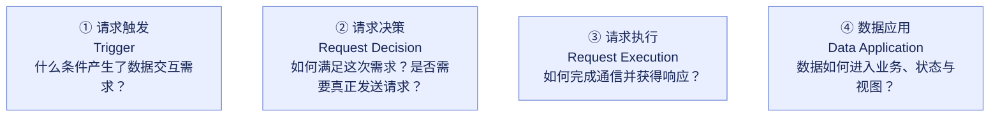
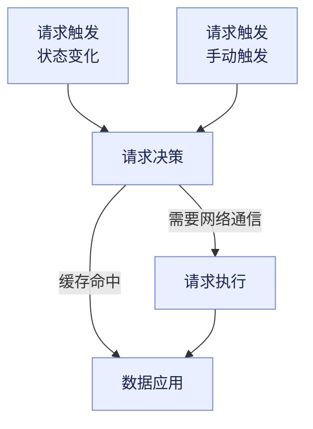
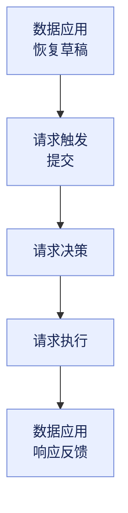
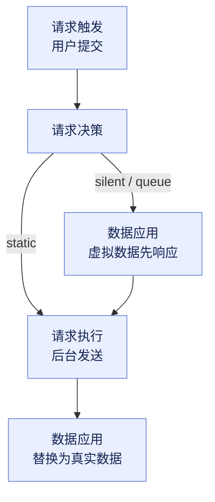

RSM（Request Scenario Model）是 alova 提出的请求场景概念模型，用于描述数据交互涉及的核心阶段，以及不同请求策略如何组织这些阶段与数据流转。

在现代应用中，请求不只是向服务器发送数据、等待响应。开发者还需要处理请求何时触发、如何决定获取数据的方式、如何执行网络通信，以及如何将数据转换并应用于业务逻辑、应用状态和视图。

alova 通过不同的请求策略，将这些能力组合成适用于不同场景的解决方案。RSM 为这些策略提供统一的概念基础，帮助开发者理解不同策略的职责，以及它们之间的区别与联系。

## 核心模型

RSM 将请求场景抽象为四个阶段：

- **请求触发（Trigger）**：什么条件产生了数据交互需求？
- **请求决策（Request Decision）**：如何满足这次需求？是否需要实际发送请求？
- **请求执行（Request Execution）**：如何进行数据通信并获得响应？
- **数据应用（Data Application）**：如何将数据用于业务逻辑、应用状态与视图呈现？

这四个阶段描述的是数据交互中的不同职责，而不是规定所有请求必须依次经过的固定流程。

### RSM 概念图

图中呈现的是四个阶段各自的职责，而不是一条请求流程。阶段之间没有固定的先后顺序，哪些阶段参与、以什么顺序参与，由所使用的请求策略决定：策略可能跳过某些阶段、重复经过某些阶段，或者同时处理不同的数据流。

## 一、请求触发（Trigger）

**请求触发回答：什么条件产生了数据交互需求？**

触发机制决定数据交互何时发生，以及什么条件会再次发起请求。它不代表网络请求一定会被发送。

常见的触发方式包括：

- **主动触发**：用户点击按钮、提交表单或显式调用请求方法。
- **初始化触发**：页面或组件初始化时获取数据。
- **状态触发**：搜索条件、筛选参数等状态发生变化。
- **时间触发**：定时刷新、延迟执行。
- **事件触发**：页面重新获得焦点、网络恢复等事件。
- **失败重试**：请求失败后，根据重试条件、次数与间隔再次发起请求。

例如，`useWatcher` 可以根据状态变化触发请求，`useAutoRequest` 可以根据指定的自动刷新条件重新发起请求，`useRetriableRequest` 则可以在请求失败后安排新的尝试。

这些策略解决的都是请求何时发生的问题，但触发后是否需要真实通信，还需要由请求决策阶段决定。

## 二、请求决策（Request Decision）

**请求决策回答：如何满足这次数据需求？**

请求触发后，并不一定需要新发起一次网络请求。alova 可以根据已有数据、正在执行的请求及当前条件，选择合适的数据获取路径。

常见的决策包括：

- **缓存命中**：直接使用已有数据，避免重复通信。
- **请求共享**：复用正在执行的相同请求及其结果。
- **请求拦截**：阻止原请求继续执行。
- **请求重定向**：改变原请求的执行路径。
- **请求挂起**：暂时等待条件满足，再继续尝试。
- **执行网络请求**：当需要通过网络获取数据时，进入请求执行阶段。

例如：

- 缓存命中时，可以直接将缓存数据交给数据应用阶段。
- 共享请求时，可以复用已有的通信过程，而不必重复发送。
- 离线时，可以暂缓请求，等待网络恢复。
- 当缓存不可用且需要获取服务端数据时，才进入请求执行阶段。

请求决策的意义在于：开发者表达的是数据需求，而策略负责决定如何满足需求。

## 三、请求执行（Request Execution）

**请求执行回答：如何进行实际的数据通信并获得响应？**

当请求决策确定需要网络通信时，请求进入这一阶段。它关注请求的发送、响应的接收，以及通信成功或失败等执行结果。

典型场景包括：

- 发送 HTTP 请求并接收服务端响应。
- 处理通信成功与失败。
- 接收 SSE 等持续传输的数据。
- 执行文件上传等特殊传输任务。

请求执行不负责决定请求何时触发，也不负责决定是否使用缓存。

因此，一次数据需求可能不产生任何新的网络通信，也可能需要多次执行才能获得所需数据。

## 四、数据应用（Data Application）

**数据应用回答：如何将数据用于实际场景？**

数据通信的目的不只是获得响应，而是让数据能够服务于业务逻辑和应用功能。

数据应用包括：

- **数据转换**：提取、格式化或转换数据，使其符合业务需要。
- **缓存沉淀**：保存数据，供后续请求或其他位置复用。
- **状态更新**：将数据写入应用状态，供后续逻辑使用。
- **数据传递**：将数据交给服务端或业务流程中的后续步骤。
- **数据同步**：将数据更新应用于其他组件、页面或相关的数据使用位置。

数据应用不局限于前端 UI，也不要求所有数据都必须经过状态更新。它描述的是数据如何被实际使用。

例如，在客户端，响应数据可以转换后写入状态并更新视图；在服务端，数据可以经过转换后直接传递给下一个业务步骤。

## 五、RSM 在请求策略中的应用

alova 提供的各种 Client hooks 和 Server hooks，可以理解为对请求策略的声明。

使用一个 Hook，意味着声明采用某种请求策略。该策略确定了自己涉及哪些 RSM 阶段，以及数据如何在这些阶段之间流转。

不同策略解决的问题不同，因此涉及的阶段和流转路径也不同。有些策略覆盖完整的请求场景，有些策略只涉及其中几个阶段，还有些策略会改变常规的流转路径。

例如：

- 普通请求通常涉及请求触发、请求决策、请求执行和数据应用。
- 缓存命中时，可以从请求决策直接进入数据应用。
- 表单草稿恢复读取的是被持久化的表单数据，可以直接恢复状态，不需要网络请求。
- 静默提交会调换阶段顺序：请求决策之后先进入数据应用（拿到的是虚拟数据），请求执行在后台进行，真实响应返回后再次进入数据应用替换虚拟数据。

### 阶段不等于固定的执行顺序

**RSM 描述的是阶段职责，而不是固定的执行顺序。**

四个阶段不是必须依次经过的线性流程。具体策略可以决定哪些阶段参与、哪些阶段跳过，以及数据如何在阶段之间流转。

需要注意，请求需求的流转与数据的流转并不完全相同：

- 请求需求决定接下来采用哪种获取数据的方式。
- 数据可能来自缓存、正在执行的请求，也可能来自新的网络响应。
- 已有数据可以直接进入数据应用阶段，而不需要重新执行网络请求。
- 一次执行失败后，可以重新触发请求，形成新的尝试。

这种设计使 RSM 能够描述不同的请求场景，而不必为每一种策略建立独立的概念模型。

## 六、RSM 策略示例

下面通过三个场景，观察不同策略涉及哪些阶段、以什么顺序参与，以及数据从哪里来、最终到哪里去。

### 示例一：useWatcher——状态变化与手动触发

当搜索条件或筛选参数发生变化时，应用需要重新获取与当前条件匹配的数据。`useWatcher` 监听指定的状态，状态变化时自动发起请求，也可以显式调用 `send` 手动触发；它支持 `useRequest` 的全部特性，但 `immediate` 默认为 `false`，因此初始化时不会自动请求。

各阶段的行为：

1. **请求触发**：有两条路径。① 状态变化：被监听的状态（如搜索关键词）发生变化，产生一次新的数据需求；请求防抖属于触发机制，配置 `debounce` 后，状态在防抖时间内再次变化会重新计时，到时间才真正产生这次需求，因此不必自己在输入框上写防抖代码。② 手动触发：显式调用 `send` 主动发起请求，初始化时 `immediate` 默认为 `false`，首次请求即可用这种方式发出。
2. **请求决策**：`abortLast` 默认为 `true`，新请求发出时会中断上一次尚未响应的请求，避免旧响应后返回时覆盖新结果；若这次请求命中缓存，则不必重复通信，直接进入数据应用。
3. **请求执行**：需要网络通信时，把请求发出去并拿到响应。
4. **数据应用**：响应数据写入 `data` 等响应式状态，视图随之更新。

这个例子说明，"什么时候需要数据"与"这次要不要真的发出去"是两件事：两种触发方式都只产生数据需求，防抖属于触发机制，竞态处理与缓存判断属于决策阶段，执行阶段只负责把请求发出去、把响应拿回来。

### 示例二：useForm 表单草稿——草稿恢复到提交反馈

`useForm` 提供表单草稿功能：将 `store` 设置为 `true` 后，未提交的表单数据会被实时持久化（通过 alova 实例上的存储适配器），因此即使页面刷新，再次打开表单时也能恢复之前填写的内容。

各阶段的行为：

1. **数据应用（恢复草稿）**：页面刷新后重新初始化时，存储中的草稿被恢复为表单数据，同时触发 `onRestore` 事件，视图呈现出之前填写的内容。这一步只用本地沉淀的数据，不涉及网络通信。
2. **请求触发**：用户提交表单，调用 `send`，产生一次提交需求。
3. **请求决策**：这次提交需要真实发送，直接进入请求执行；草稿只是本地数据，不影响这次提交。
4. **请求执行**：发送表单数据并获得响应。
5. **数据应用（提交反馈）**：响应结果反馈到页面——提交期间展示 loading，成功、失败与完成分别触发 `onSuccess`、`onError`、`onComplete`；提交成功后（配置 `resetAfterSubmitting` 或手动调用 `reset`）表单回到初始状态，已沉淀的草稿也会被清空。

这个例子说明，同一个策略可以覆盖多个阶段：草稿恢复是数据应用的起点，提交是新的触发，而响应再次回到数据应用，用于页面反馈。

### 示例三：静默提交——先响应，后提交

在提交即响应的场景中，用户不应该等待网络往返。`useSQRequest` 的 `behavior: 'silent'` 会把请求交给静默队列：调用结果立即返回，请求在后台按队列顺序真正发送。

各阶段的行为：

1. **请求触发**：用户的提交操作（新增、编辑、删除）产生数据需求。
2. **请求决策**：`behavior` 决定这次请求的处理路径——`silent` 进入静默队列并被持久化，`queue` 进入队列但不持久化，`static` 不进入队列、立即发送（相当于关闭静默提交）。
3. **数据应用（立即）**：`silent` 模式下会立即触发响应回调，`onSuccess` 收到的是虚拟数据，即服务端响应数据的占位（例如新建数据时由 `silentDefaultResponse` 生成的 id）。应用先用它更新状态与视图，操作结果立即可见。
4. **请求执行（后台）**：静默队列按顺序真正发送请求，队列内前一个请求响应后才发起下一个，从而保证时序；失败时按 `maxRetryTimes`、`backoff` 等参数重试；`silent` 请求被持久化，刷新页面后由 `bootSilentFactory` 继续发送。
5. **数据应用（响应后）**：真实响应返回后，借助虚拟数据的追查机制，分布在状态、缓存与视图中的虚拟数据会被自动替换为真实数据（如服务端返回的真实 id），必要时再结合保存的操作记录做数据补偿。

这个例子的阶段顺序与常规请求不同：数据应用发生在请求执行之前。同时需要注意，"响应回调已经执行"并不代表"请求已经成功"——`silent` 模式下 `onError` 永远不会被触发，失败由静默队列的重试策略以及 `onSilentSubmitFail`、`onFallback` 等事件接管。

它说明，请求执行与数据应用是两个独立的阶段：谁先谁后、数据以什么形态被应用，取决于具体的请求策略。
