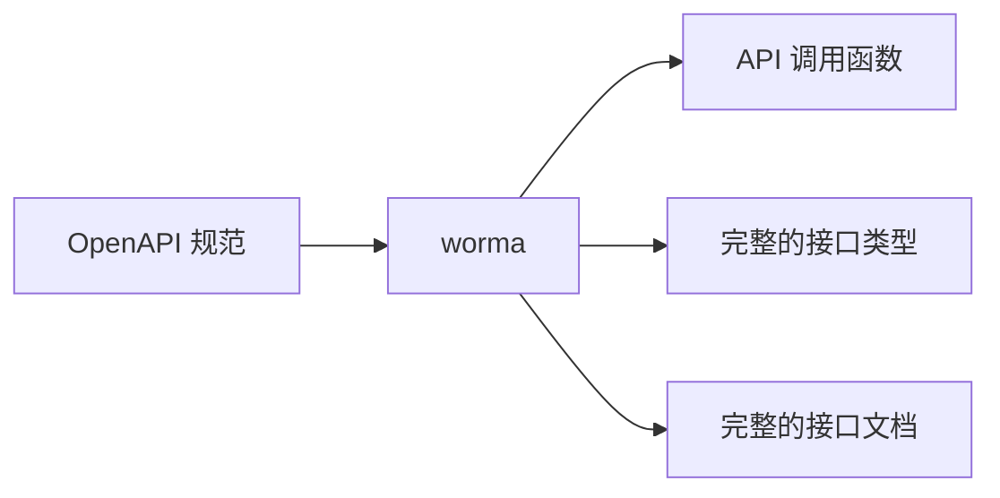
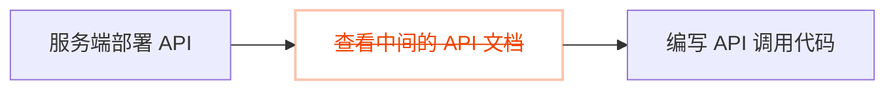

import Link from '@docusaurus/Link';
import NavCard from '@site/src/components/NavCard';
import Examples from '@site/src/components/Examples';
import SupportList from '@site/src/components/SupportList';
import tts from '@site/static/audio/tts.mp3';
import AudioPlayer from '@site/src/components/AudioPlayer';
import IconFont from '@site/src/components/IconFont';
import Tabs from '@theme/Tabs';
import TabItem from '@theme/TabItem';
import SponsorStrip from '@site/src/components/SponsorStrip';

## alova 是什么？

alova（读作`/əˈləʊva/`<AudioPlayer src={tts} />）是一个 **请求策略库**：以场景为请求的基本单元，把分页、表单、上传、重试这些你已经手写过无数遍的请求逻辑，封装成 20+ 个开箱即用的请求策略。

请求不是一次瞬时的调用，它是一个有生命周期的场景。你不必扔掉已经用惯的 axios 或 fetch，alova 直接架在你现有的请求库之上，接管那些你每次都要重写一遍的请求逻辑。同一套 API 横跨 React、Vue、Svelte、Solid、小程序与服务端，一次学会，处处都能用。

你可以在 [为什么创造 alova](/about/faqs) 中了解背景故事，在 [与其他请求库对比](/about/comparison) 中了解 alova 的差异，或前往 [请求场景模型（RSM）](/about/RSM) 了解 alova 的概念基础。

### 请求场景模型（RSM）简介

RSM（Request Scenario Model）将一次请求场景展开为四个阶段，每个阶段回答一个问题：

| 阶段 | 回答什么 | 说明 |
| --- | --- | --- |
| **请求触发** | 什么条件产生了数据交互需求？ | 初始化、状态变化、自动刷新、失败重试、防抖、轮询——触发不等于发送，需求产生了，网络不一定动 |
| **请求决策** | 如何满足这次需求？要不要真的发？ | 命中缓存、复用在途请求、挂起等待、丢弃过期响应，都发生在这一步 |
| **请求执行** | 如何通信并获得响应？ | 交给 axios / fetch / XHR——**通常只有一行代码** |
| **数据应用** | 数据如何进入业务、状态与视图？ | 数据转换、状态更新、跨组件/跨页面同步、缓存沉淀 |


值得留意的是：四段里「执行」通常只有一行，而「触发」散在组件的数据监听里，「应用」散在状态赋值与视图更新里，而「决策」往往是被人忽略的。完整说明见 [请求场景模型（RSM）](/about/RSM)。

### 用 alova 能得到什么

#### 一、交付的是完整的场景，不是能跑的请求


让 AI 从零写，这些词大概率一个都不会出现在你的 prompt 里，不是 AI 能力不够，是你没提。而“该提哪些词”，从来没人给过你一张清单。而 RSM 就是那张清单，alova 把这份清单落到了场景 hooks 的配置项里，一次声明，整个场景到位。

- **输入防抖**：不写，快速输入就连发请求
- **相同条件命中缓存**：不写，同一个接口反复打
- **过期响应丢弃**：不写，旧响应可能覆盖新结果
- **失败自动重试**：不写，一失败页面就白屏
- **下一页预取**：不写，用户每次翻页都盯着 loading


#### 二、无需审核ai写的代码

页面中请求层代码会占用很大一部分，ai写的代码总是需要我们重新review一遍，使用alova后请求层只需要核的配置即可，为你节省了时间的同时还提升稳定性。


### 什么时候该用 alova？

alova几乎可以在任何JavaScript运行时中运行，如果你的前端应用中包含权限验证、分页、表单、上传、验证码发送等功能，或需要在 Web、React-Native、小程序中跨端复用同一套 API，或需要在Nodejs、Bun服务端做限流、BFF等请求治理，alova 都可以完美胜任。

## 特性

- 简单易用，[观看视频](/video-tutorial)5分钟上手。
- 完美兼容你最喜欢的技术栈。
- 20+ 高性能的业务模块，帮助你快速开发性能更好的应用。
- 更先进的 openAPI 解决方案，在代码中和API信息高效交互。
- 请求共享和响应缓存，提升应用性能。
- 类型安全。

alova 兼容以下技术栈，灰色部分将在未来逐渐支持。

<SupportList showStatus></SupportList>

## 请求策略实战

下面挑几个最常用的请求策略，让你感受一下实际写法——点开任意一项即可。

### 客户端请求策略

以下是部分客户端请求策略的介绍和示例，请选择你感兴趣的展开查看。

<details>
<summary>监听请求策略</summary>

随数据变化自动重新请求，例如模糊搜索、tab 栏切换等。

```javascript
const {
  // 响应式状态
  loading,
  error,
  data,

  // 事件
  onSuccess,
  onError,
  onComplete,

  // 操作函数
  send,
  update

  // ...
} = useWatcher(
  () =>
    alova.Get('/api/user', {
      params: {
        type: activeTab
      }
    }),
  [activeTab]
);
```

前往[监听请求策略](/tutorial/client/strategy/use-watcher) 查看详情。

</details>

<details>
<summary>分页请求策略</summary>

完整的分页场景：翻页、条件查询、下一页预拉取、插入/替换/移除数据项、刷新和重置。

```javascript
const {
  // 响应式状态
  loading,
  error,
  data,
  page,
  pageSize,
  total,

  // 事件
  onSuccess,
  onFetchSuccess,
  onError,
  onFetchError,

  // 操作函数
  refresh,
  insert,
  replace,
  remove,
  reload,
  send,
  abort,
  update

  // ...
} = usePagination(
  (page, size) =>
    alova.Get('/api/user/list', {
      params: { page, size }
    }),
  {
    preloadNextPage: true,
    watchingStates: [username, sex],
    debounce: 500
  }
);
```

前往[分页请求策略](/tutorial/client/strategy/use-pagination) 查看详情。

</details>

<details>
<summary>Token身份认证策略</summary>

全局拦截器，统一维护登录、登出、token 附带与无感刷新等认证逻辑。

```javascript
const { onAuthRequired, onResponseRefreshToken } = createServerTokenAuthentication({
  refreshTokenOnError: {
    isExpired: res => res.status === 401,
    handler: async () => {
      const { token, refresh_token } = await refreshToken();
      localStorage.setItem('token', token);
      localStorage.setItem('refresh_token', refresh_token);
    }
  }
});
const alovaInstance = createAlova({
  beforeRequest: onAuthRequired(),
  responded: onResponseRefreshToken()
});
```

前往[Token 认证拦截器](/tutorial/client/strategy/token-authentication) 查看详情。

</details>

<details>
<summary>表单提交策略</summary>

快速实现表单草稿、多步骤表单，并内置表单重置等常用功能。

```javascript
const {
  // 响应式状态
  loading: submiting,
  error,
  form,

  // 事件
  onSuccess,
  onError,
  onComplete,

  // 操作函数
  send: submit,
  updateForm,
  abort

  // ...
} = useForm(formData => alova.Post('/user/profile', formData), {
  initialForm: {
    name: '',
    age: '',
    avatar: null
  },
  resetAfterSubmiting: true,
  store: true
});
```

前往[表单提交策略](/tutorial/client/strategy/use-form) 查看详情。

</details>

<details>
<summary>数据拉取策略</summary>

提前拉取数据，用户无需等待加载，提升体验。

```javascript
const {
  // 响应式状态
  loading,
  error,

  // 事件
  onSuccess,
  onError,
  onComplete,

  // 操作函数
  fetch,
  update,
  abort

  // ...
} = useFetcher();

const handleItemClick = itemId => {
  fetch(
    alova.Get('/api/user/detail', {
      params: {
        id: itemId
      }
    })
  );
};
```

前往[数据预拉取](/tutorial/client/strategy/use-fetcher) 查看详情。

</details>

<details>
<summary>无感数据交互策略</summary>

像操作本地数据一样即时响应，提交与展示均无需等待，大幅提升流畅度。

```javascript
const {
  // 响应式状态
  data,
  loading,
  error,

  // 事件
  onSuccess,
  onError,
  onComplete,
  onBeforePushQueue,
  onPushedQueue,
  onFallback,

  // 操作函数
  send: submit,
  abort,
  update

  // ...
} = useSQRequest(() => alova.Get('/api/todo/add'), {
  behavior: 'silent',
  queue: 'queue-demo',
  silentDefaultResponse: () => {
    return {
      id: '--'
    };
  }
});
```

前往[无感数据交互](/tutorial/client/strategy/seamless-data-interaction) 查看详情。

</details>

<details>
<summary>跨组件请求触发中间件</summary>

打破组件层级限制，在任意组件中触发任意请求的操作函数。

<Tabs className="file-tabs">
<TabItem value="1" label="ComponentA">

```javascript
useRequest(alova.Get('/api/todo/list'), {
  // ...
  middleware: actionDelegationMiddleware('action:todoList')
});
```

</TabItem>
<TabItem value="2" label="ComponentB">

```javascript
accessAction('action:todoList', delegatedActions => {
  delegatedActions.send();
  delegatedActions.abort();
});
```

</TabItem>
</Tabs>

前往[跨组件触发请求](/tutorial/client/strategy/action-delegation-middleware) 查看详情。

</details>

<details>
<summary>验证码策略</summary>

快速实现验证码发送。

```javascript
const mobile = ref('');
const {
  // 响应式状态
  loading: sending,
  countdown,
  error,

  // 事件
  onSuccess,
  onError,
  onComplete,

  // 操作函数
  send,
  abort,
  update

  // ...
} = useCaptcha(
  () =>
    alova.Post('/api/captcha', {
      mobile: mobile
    }),
  {
    initialCountdown: 60
  }
);
```

前往[验证码策略](/tutorial/client/strategy/use-captcha) 查看详情。

</details>

请前往 [请求策略列表](/tutorial/client/strategy) 查看全部客户端请求策略。

### 服务端请求策略

在服务端（nodejs/deno/bun）中，alova 同样提供了服务端请求策略，称为 **server hooks**，均支持集群模式。

以下是部分server hooks的介绍和示例，请选择你感兴趣的展开查看。

<details>
<summary>多进程原子化请求</summary>

集群模式下请求时，保证同一时间只有一个进程发起请求。

```javascript
const tokenRes = await atomize(alova.Get('/api/access_token'));
```

前往[原子化请求](/tutorial/server/strategy/atomize) 查看详情。

</details>

<details>
<summary>请求重试策略</summary>

请求失败时重新发起请求。

```javascript
const response = await retry(alova.Get('/api/user'), {
  retry: 5
});
```

前往[请求重试策略](/tutorial/server/strategy/retry) 查看详情。

</details>

<details>
<summary>请求速率限制策略</summary>

限制在一定时间的请求次数，支持集群模式。

```javascript
const limit = createRateLimiter({
  points: 4,
  duration: 60 * 1000
});
const orderRes = await limit(alova.Get('/api/order'));
```

前往[请求速率限制策略](/tutorial/server/strategy/rate-limit) 查看详情。

</details>

## worma：写一份接口规范，剩下的交给它

worma是一个基于ai skills的请求代码生成器，它对alova开箱即用，它读取你的 OpenAPI 规范，一次性帮你产出类型安全的调用代码、每个接口的 TypeScript 类型、完整的接口文档，以及**能让 AI 编码助手直接读懂的接口知识**——你的 Agent 不再靠猜，而是能直接找到需要的接口。



过去，你拿到接口后要打开中间文档、查参数、再回到编辑器手写代码；现在 worma 帮你消掉了中间的文档环节。在编辑器里你就能直接找到需要的接口、查看它的完整文档、照着参数表快速填参，前后端协作像穿过一条虫洞。



> 前往 [worma.js.org](https://worma.js.org) 了解更多，或在 [集成 OpenAPI](/tutorial/getting-started/openapi-integration) 指南中查看如何接入。

## 在线体验

这里为你准备了丰富的示例，帮助你快速体验 alova 的各种功能。

<Examples />

## 用 AI Agent 写 alova（Agent Skills）

用 AI 编码助手开发？安装 alova 的 [Agent Skills](/tutorial/getting-started/agent-skills)，让 Agent 按官方最佳实践帮你写代码。

## 构建 Client-Server 交互层

通过 alova 的各种特性，你还可以为你的项目构建 Client-Server 交互层（CS 交互层），CS 交互层将会以合并相同请求的方式分发响应数据到各个组件中，此外，CS 交互层还管理响应数据和 useHooks 所创建的响应式状态，你可以在任意的 UI 组件中访问和修改 CS 交互层的数据，以及刷新 CS 交互层数据。

> 如果你想要构建 CS 交互层，请参考[构建 Client-Server 交互层](/tutorial/project/best-practice/csil)

## 迁移指南

- [从 v2 迁移到 v3](/tutorial/project/migration/v2-to-v3)
- [从 axios 低成本迁移到 alova 的指南](/tutorial/project/migration/from-axios)

## 加入 alova 社区

import ImgDiscord from '@site/static/img/discord.svg';
import ImgX from '@site/static/img/x.svg';
import ImgWechat from '@site/static/img/wechat.svg';
import wechatQrcode from '@site/static/img/wechat_qrcode.jpg';

<NavCard list={[
{
Image: <ImgDiscord />,
title: 'Discord',
desc: '社区的 GPT 机器人为你解答',
link: 'https://discord.gg/S47QGJgkVb',
target: '__blank'
},
{
Image: <ImgWechat />,
title: '微信',
desc: '在群聊交流，更快获得回应',
link: wechatQrcode,
target: '__blank'
},
{
Image: <ImgX />,
title: 'X',
desc: '关注我们，持续获得最新动态',
link: 'https://x.com/alovajs',
target: '__blank'
}
]}></NavCard>

<SponsorStrip hideSection />

## 欢迎参与贡献

在参与贡献前，请务必详细阅读 [贡献指南](/contributing/overview)，以保证你的有效贡献。

## 让我们开始吧

接下来，我们将从最简单的请求开始，再到请求策略的讲解，了解 alova 如何简化你的工作，再深入到进阶指南，以及在实际项目中总结的最佳实践。

让我们开始学习 alova 吧！

<NavCard list={[
{
Image: <IconFont name="shipin" />,
title: '5 分钟快速入门视频',
desc: '在 5 分钟内学会使用 alova',
link: '/video-tutorial'
},
{
Image: <IconFont name="wenjian" />,
title: '快速开始文档',
desc: '更详细地学习 alova，自由掌控学习时间',
link: '/tutorial/getting-started/quick-start'
}
]}></NavCard>
